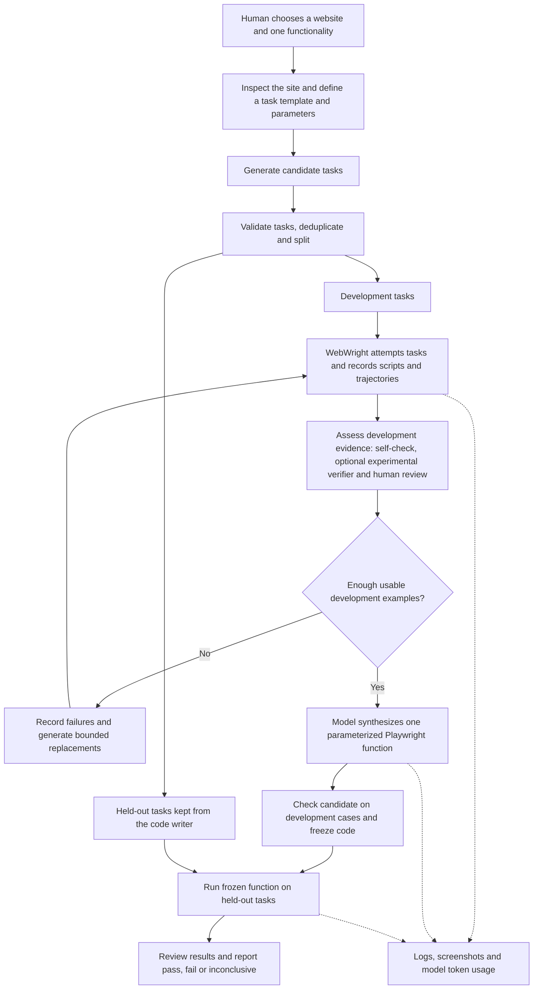

# function_gen

Website Function Generator — research snapshot.

This repository contains an experimental pipeline for generating one
parameterized Playwright function from a website and a human-selected
functionality. It also includes selected functions produced by this and earlier
automated pipelines. This is a **research snapshot**, not a deployment-ready
product or a guarantee that the system works on arbitrary sites.

## Pipeline

The pipeline below represents the workflow used for the public isolated runner.
The experimental independent verifier and the final held-out checks have
important limitations described below. Depending on the chosen mode, some
checks may be ungraded rather than semantic pass/fail judgments.

This diagram is conceptual, not a claim that each box is fully automated or
that the experimental verifier proves correctness. WebWright self-reflection,
process exit 0 and screenshots alone do not establish semantic success.
Replacement rounds and resource limits can end a run with too few examples.
Development tasks may use up to seven isolated workers in the public runner;
that parallelism has only been tested offline. An authenticated account's
server-side state is still shared between workers.

## Files

- [Pipeline source and instructions](research/website_tool_suite_generator_v1/site_neutral_task_pipeline_v1/README.md)
- [Diagnostic logging guide](research/website_tool_suite_generator_v1/site_neutral_task_pipeline_v1/DIAGNOSTIC_LOGGING.md)
- [Experimental verifier notes](research/website_tool_suite_generator_v1/site_neutral_task_pipeline_v1/VERIFIER.md)
- [Supporting v73 code](research/website_tool_suite_generator_v1/pipeline_codex_v73/)
- [Generated function examples and task/prompt provenance](functions/README.md)
- [Vendored Microsoft WebWright](research/website_tool_suite_generator_v1/vendor/Webwright/), including its own license and notices. The source snapshot came from upstream commit `35dbcf389ce2d9a77eb22f539c79a1274ea53559`.

## Setup limitations

This snapshot preserves the actual implementation for review, but it has **not
been validated as a standalone installation on another machine**. In
particular:

- Some code has absolute `/shared/hans/...` paths, including the project root,
  spend ledger and credential file location. These must be made configurable or
  adapted before running elsewhere.
- The experiment used an external `local_api_logger` helper supplied in the
  original environment. It is **not included** here; its complete redistribution
  terms and standalone setup have not been established. The original code also
  writes to a central spend ledger, which this snapshot does not contain.
- Python dependencies, browser binaries, Docker and provider credentials are
  environment-specific. The original runtime and authenticated Youdao sessions
  are not bundled. Never commit credentials, cookies or session files.
- The WebWright sandbox and visual verifier are experimental; read-only browser
  behavior is not a hard guarantee. Live website behavior, login requirements
  and model availability may change.

This upload omits historical raw run logs, browser sessions, private
screenshots and Youdao test-account task/prompt records; those originals remain
in the research workspace. The
source code and public arXiv task/prompt examples are included for review. A
basic pattern scan was performed but is not a guarantee that no sensitive
information remains; review before publication. Do not publish raw experiment
artifacts without checking their contents and permissions.

Selected generated functions are historical research artifacts, not claims of
present-day correctness. See their per-function status and safety notes in the
functions guide. The code can incur model costs and visit external sites;
obtain the necessary authorizations before running it.
